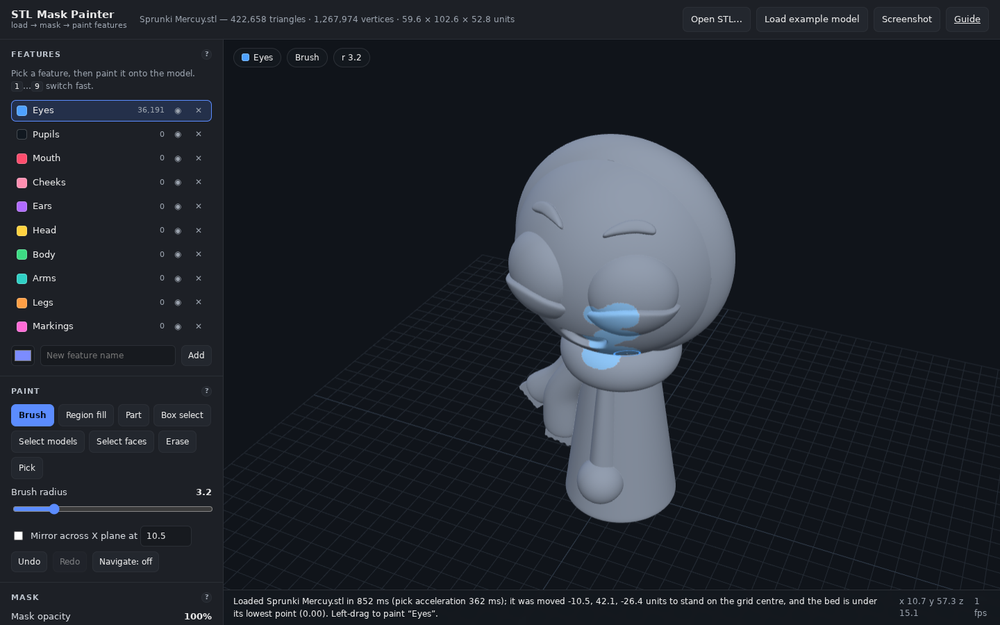

# STL Mask Painter

Paint named features — an eye, a mouth, a marking — onto the surface of an STL model, then export
that paint as a **printable paint stencil**: a one-piece shell that conforms to the model, so only
the painted area is exposed to the brush. The paint also exports as JSON (re-importable, so a mask
session can be grown later) and as a per-vertex-coloured PLY of the painted shell.

## ▶︎ Run it

### [Open the app](https://bradman85.github.io/stl-mask-painter/)



That link is this repository, served by **GitHub Pages** — the app is a static site with no build
step and no dependencies to install, so it runs in any browser, on any device, and every push to
`main` updates it. Start with **Load example model** (the bundled `Sprunki Mercuy.stl`, 422,658
triangles), or drop your own `.stl` anywhere on the viewport.

### Run it from inside GitHub, without installing anything

[](https://codespaces.new/bradman85/stl-mask-painter)

A browser-only cloud workspace (free tier: 60 hours a month). The dev container starts the bundled
server on port 8137 and forwards it, opening the app on its own — if the preview does not open,
take the **Ports** tab and open the address for **8137**.

### Run it on your own machine

```bash
git clone git@github.com:bradman85/stl-mask-painter.git
cd stl-mask-painter/mask-painter
node serve.mjs                  # http://127.0.0.1:8137/mask-painter/index.html
node serve.mjs 3000 0.0.0.0     # pick another port / reach it from a phone on the same network
```

ES modules and `fetch` mean the app has to be served over HTTP: opening `index.html` from disk with
`file://` will not work. The bundled server serves the **parent** directory, so the example model
next to the app folder is reachable. No `npm install` is needed to run the app — the tests are the
only thing that wants `npm ci` (they use the vendored copies in `mask-painter/vendor/`).

## Documentation

| | |
| --- | --- |
| [`mask-painter/README.md`](mask-painter/README.md) | the full manual: tools, the mask, stencils, exports, and the why behind them |
| [`mask-painter/help.html`](mask-painter/help.html) | the same material as the in-app guide (**Guide** in the top bar) |
| [`mask-painter/VALIDATION.md`](mask-painter/VALIDATION.md) | the checklist every feature is verified against, item by item |
| `mask-painter/test/` | the automated half: nine suites, run with `cd mask-painter && npm test` |

## Other files in this repository

The Pages site is served from this branch's root, so the site's own files (`index.html`,
`.nojekyll`, `mask-painter/`, `Sprunki Mercuy.stl`) sit beside unrelated CAD and preview material —
OpenSCAD sources, pinhole-disc STLs and rendered previews — which the site ignores.
